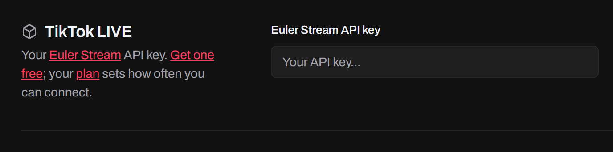
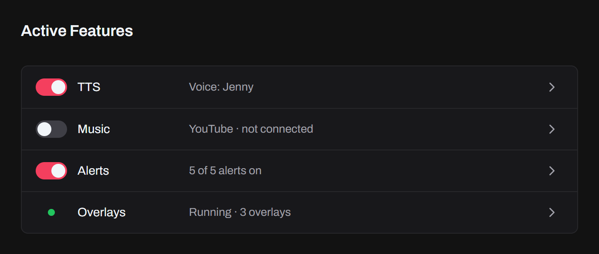
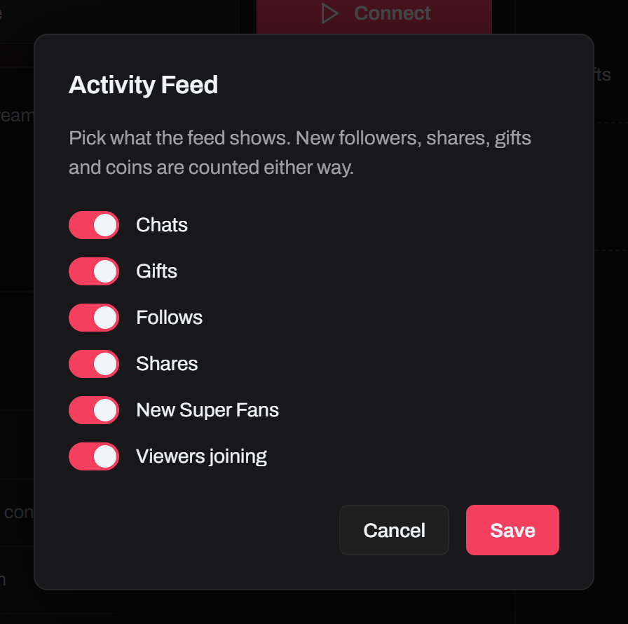

import { Steps } from "@astrojs/starlight/components";

Set everything up before you start your LIVE. Tokio can only connect once the LIVE has started.

<Steps>

1. **Install Tokio**

   Download it from the [download page](/download/). See [Install](/docs/install/) for each system.

2. **Set it up**

   Get a free API key from [Euler Stream](https://www.eulerstream.com/register) and paste it in **Settings → TikTok LIVE**. You only do this once.

   

   Then pick your [voice](/docs/features/text-to-speech/), connect your [music](/docs/features/music-requests/), and set up your [alerts](/docs/features/alerts/) and [overlays](/docs/features/overlays/).

3. **Prepare your stream**

   On **Home**, under **Active Features**, turn on **TTS**, **Music** and **Alerts** as you need them. They stay as you leave them. Add your overlays to OBS or TikTok LIVE Studio: see [Adding an overlay](/docs/guides/adding-an-overlay/).

   

4. **Go live and connect**

   Start your LIVE on TikTok. Then enter your `@username` on **Home** and click **Connect**.

</Steps>

## While you're LIVE

**Home** shows your LIVE's numbers and an **Activity** feed of chats, gifts, follows, shares, new Super Fans and viewers joining. The feed stays after the LIVE ends, until the next one. Its gear picks which events it shows.

Turning a feature off during the LIVE stops what it has queued. Keep Tokio open while you stream, so your overlays keep getting events.

## When something fails

If Tokio can't connect, it says why: the LIVE hasn't started, the username wasn't found, or your Euler Stream key is missing, wasn't accepted or hit its [plan's](https://www.eulerstream.com/pricing) limit.

If the connection drops, Tokio reconnects on its own and tells you when it's back. Other problems, like a sound that's missing, show as notifications, and the bell in the title bar keeps them.
