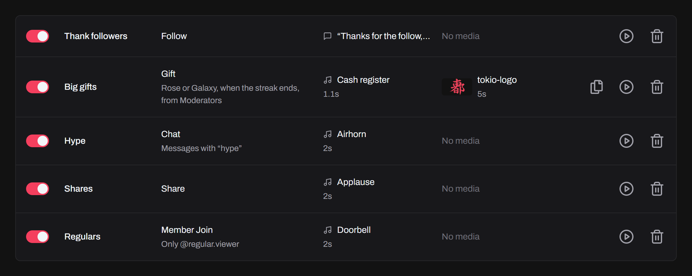
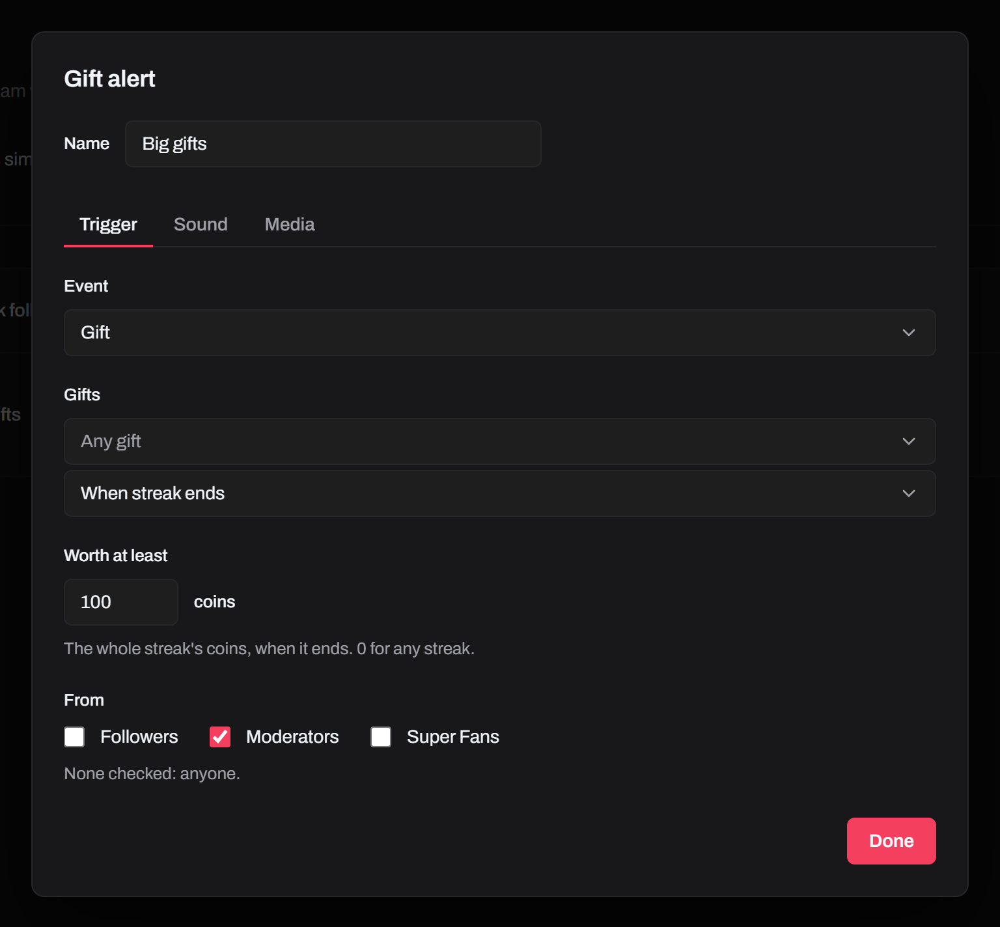
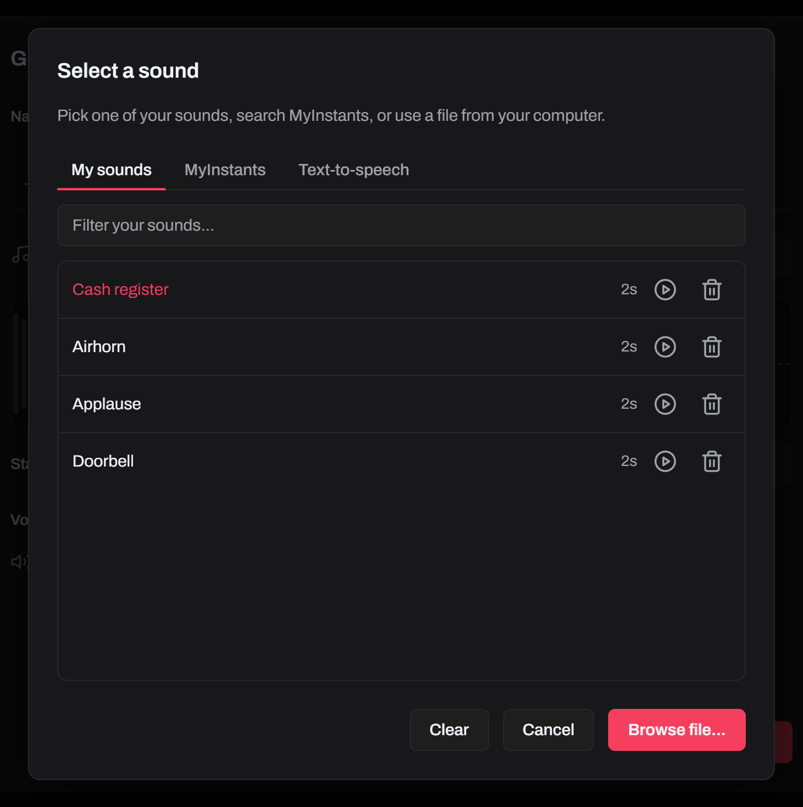
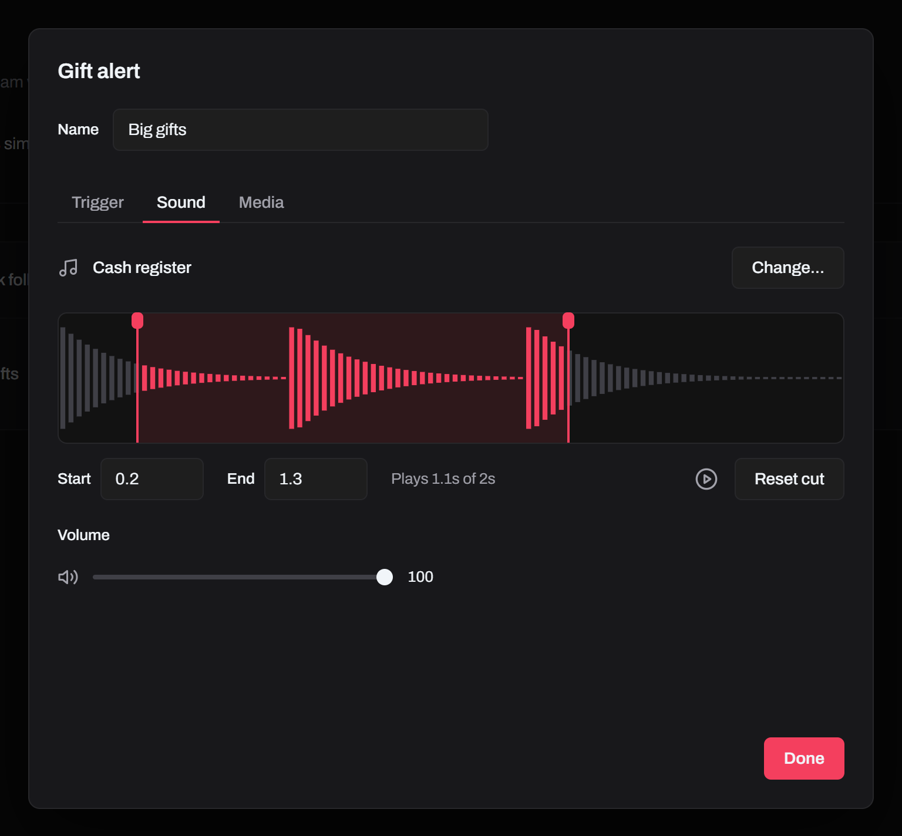
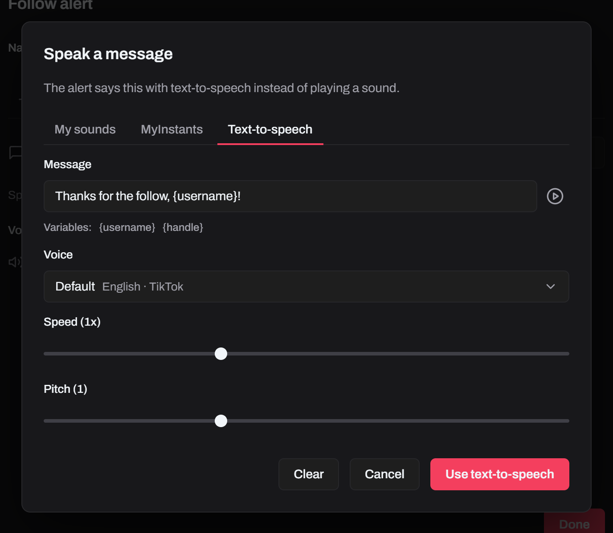
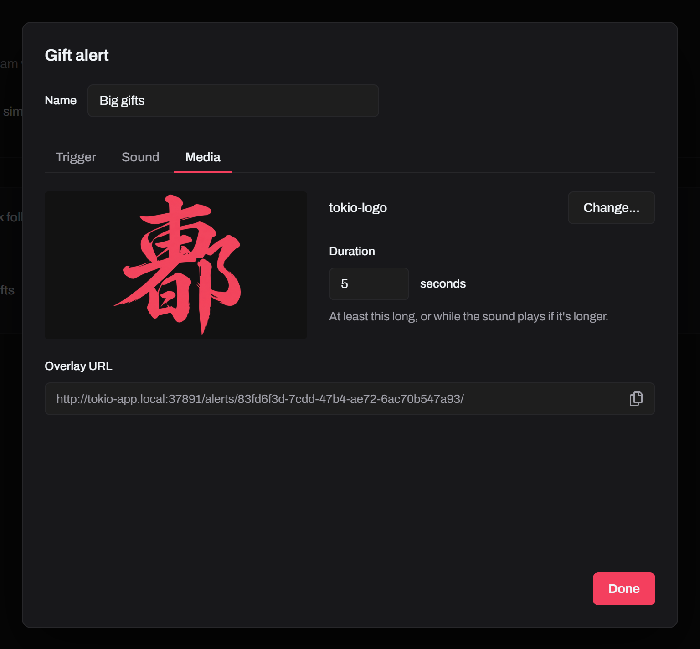
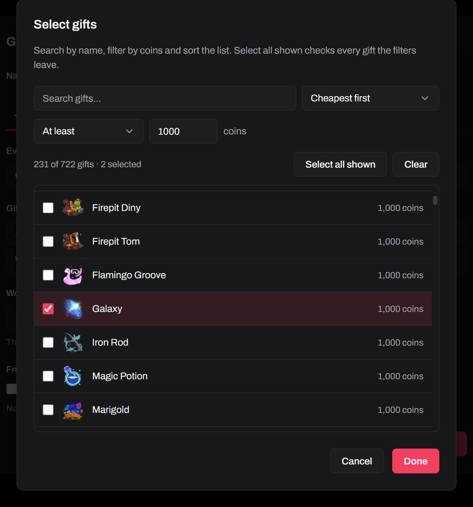
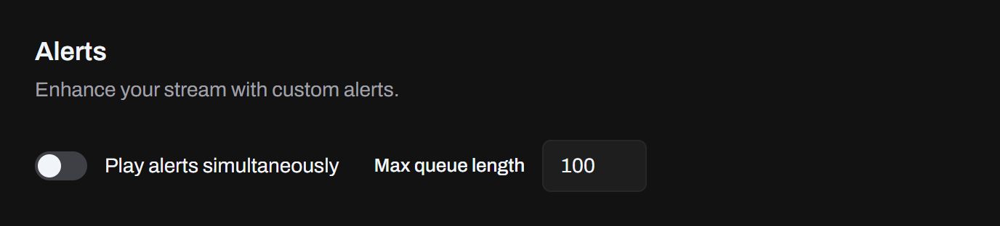

Play a sound or a spoken message, show an image or a video, or both, when something happens in your LIVE. Set them up on the **Alerts** page, and turn **Alerts** on under **Active Features** on **Home**.



Each row sums up an alert: its name, what sets it off, what it plays and for how long, and what it shows. Its switch turns it on and off, and its play button previews it. An alert with an image or a video also has a button that copies its overlay URL. Alerts belong to the profile; your sounds and media are shared by all profiles.

Click **Add alert**, then click the alert to open its editor. Type its **Name** at the top: a new alert is named by its place in the list, like alert-3. Under the name are three tabs: **Trigger**, **Sound** and **Media**. Changes save as you make them, and **Done** closes it.

To find an alert, click the search button next to **Add alert** and type part of its name.

## Triggers

On the **Trigger** tab, pick the **Event**: Chat, Emote (a chat message with emotes), Follow, Share, Like, Gift, Envelope, Super Fan, Super Fan Box, Super Fan Join, Member Join or Music Change (a new song from [music requests](/docs/features/music-requests/)).



Under **From**, check **Followers**, **Moderators** or **Super Fans** to play the alert only for viewers who are one of them. With none checked, it plays for anyone. Follow doesn't have it, since the viewer only just followed, and neither do Envelope, Super Fan Box and Music Change, which come without a viewer.

## Sounds

On the **Sound** tab, click **Choose sound...** (**Change...** once it has one) to pick one of your sounds, search [MyInstants](https://www.myinstants.com), or **Browse file...** for an mp3, wav or ogg up to 8 MB.



**Clear** takes the sound off the alert and keeps it in your library. Manage the library in **Settings → Sound Library**.

**Volume**, under the sound, is how loud the sound or message plays. A video has its own, on the **Media** tab.

## Cutting a sound

The **Sound** tab shows the sound's waveform, with the part that plays in rose. Drag its handles to cut the start or the end, or type the seconds in **Start** and **End**. With a handle focused, the arrow keys move it by a tenth of a second, or a second with Shift.



The play button next to **Reset cut** plays only the cut, with a line running along it, and so does the one on the alert's row. A sound cut before its end fades out quickly, so it doesn't click. **Reset cut** plays the whole sound again. The file stays as it is, so other alerts can play the same sound whole or cut it their own way. The alert's row shows how long the cut plays.

## Spoken messages

On the picker's **Text-to-speech** tab, type a message, pick its voice, speed and pitch, and press **Use text-to-speech**. Messages play whole. Test one with the play button next to **Change...**.



Click a variable to add the event's details:

- `{username}` and `{handle}`: every trigger with a viewer, so all but Envelope, Super Fan Box and Music Change
- `{comment}`: Chat and Emote
- `{gift}` and `{count}` (the combo size): Gift
- `{count}` (the likes sent): Like
- `{song}`: Music Change

The **TTS** page's replacements, **Remove Emojis**, banned words, cooldown and queue length apply too, so a busy LIVE can't flood the voice.

## Images and videos

On the **Media** tab, click **Choose media...** to show a png, jpg, gif, webp, mp4 or webm, up to 50 MB, with the alert's sound or on its own.



- An image's **Duration** is how long it stays, in seconds, up to 60, or longer if the sound plays longer.
- A video stays while it plays, up to 60 seconds. **Cut** keeps part of it, like a sound's cut: drag the handles, type the seconds in **Start** and **End**, or use the arrow keys. The preview shows the frame where a handle stops and the cut's length in its corner, and its play button plays only the cut. **Reset cut** plays the whole video again. Another video starts whole.
- A video that doesn't say its length, like some recordings, can't be cut: set its **Duration** instead.
- A video plays its own sound, at its own **Volume**, apart from the alert's sound.
- Browsers play a page's video muted until you click the page. When you test the overlay in a browser tab, click it once, and the next videos play with sound. OBS's browser source plays the sound without a click.
- Manage your media in **Settings → Media Library**.

Each alert shows its media on its own overlay, so you can place it anywhere. Copy the **Overlay URL**, here or with the copy button on the alert's row, and add it to your streaming app (see [Adding an overlay](/docs/guides/adding-an-overlay/)), then press the alert's play button to check it:

```
http://tokio-app.local:37891/alerts/<alert-id>/
```

## Gift alerts

On the **Trigger** tab, click **Any gift** to pick gifts. Search them, filter them by price and sort them. **Select all shown** checks every gift the filters leave, like all gifts of 1,000 coins or more. With none checked, the alert plays for any gift. The alert's row names up to three of them and counts the rest, like "Rose, Lion or 230 more".



Under the gifts, choose when it plays:

- **When streak ends**: once per combo, so a streak of 20 roses plays it once. The default.
- **Every gift**: once per gift, up to the queue's length.

With **Any gift**, **Worth at least** plays it only for gifts worth that many coins: the whole streak when it ends, so 20 roses of 1 coin are worth 20, or each gift on **Every gift**. 0 plays it for any. Once you pick gifts, the alert is for those, whatever they're worth.

TikTok's gift list misses some gifts, like other regions' ones. Tokio adds the ones viewers send, for all profiles.

## Chat, emote and join alerts

- **Chat**: type a keyword or phrase to play only for messages with it as a whole word. **hi** plays for "Hi there!" but not for "this", in any case.
- **Emote**: click **Any emote** to pick emotes. TikTok doesn't list a LIVE's emotes, so the list fills as viewers use them.
- **Member Join** and **Super Fan Join**: type an @handle or name to play only for that viewer, like an entrance sound for a regular.

## Queue

Alerts play one at a time. **Max queue length** drops the extras in a burst, and **Play alerts simultaneously** lets different triggers play at the same time.



An alert with media holds the queue for its duration, so keep it short for frequent events like likes. A cut sound holds it only for the part that plays. Alerts stop when you disconnect or turn them off.
