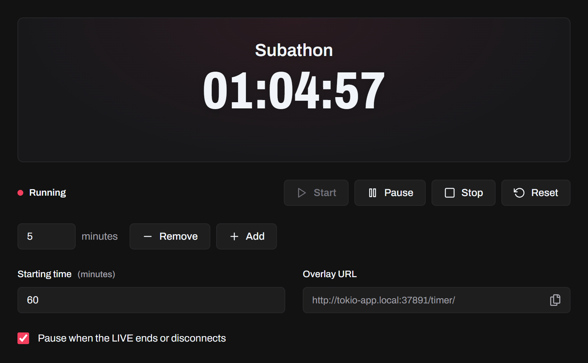
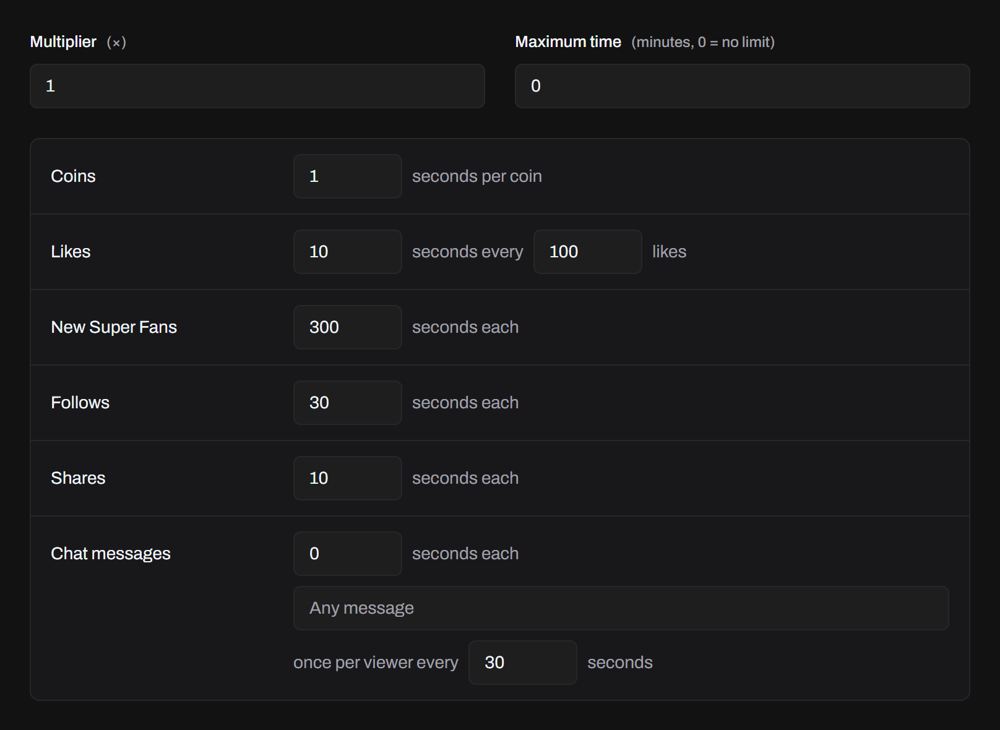
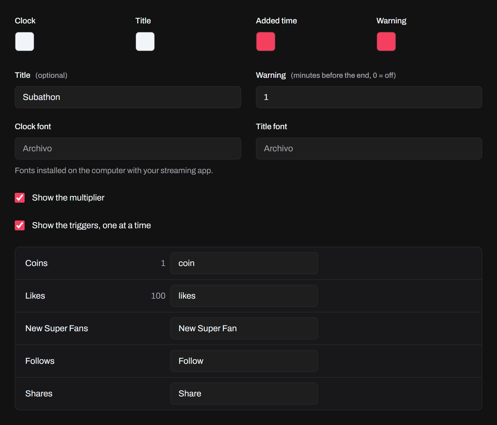

Run a subathon-style countdown that viewers add time to with gifts, likes, follows, shares, new Super Fans and chat. Set it up on the **Tools** page.

## Add it to your stream

Turn on the overlay server in **Settings → Overlay Server**, and add the timer's overlay to your streaming app like any other (see [Adding an overlay](/docs/guides/adding-an-overlay/)). The clock grows to fill the source.

```
http://tokio-app.local:37891/timer/
```

## Controls



- **Start** runs the clock from the **Starting time**, or carries on.
- **Pause** holds the clock. Events still add time.
- **Stop** holds it, and events add nothing until you **Start** again.
- **Reset** puts the starting time back, after you confirm.
- **Add** and **Remove** change the clock by the minutes you enter, say for a donation from elsewhere.

At 0 the clock stops: add time or reset it to go on. It keeps running when you leave **Tools**, and pauses when the LIVE ends or Tokio disconnects, unless you turn off **Pause when the LIVE ends or disconnects**.

## Time added

Set the seconds each event adds, or 0 to leave it out: per coin of the gifts sent, every so many likes, and for each new Super Fan, follow, share and chat message.



- **Multiplier** multiplies every event, like 2 for a double-time hour.
- **Maximum time** stops adding time once the clock reaches it. 0 is no limit.
- Chat messages count only with the keyword you enter, matched like a [chat alert's](/docs/features/alerts/#chat-emote-and-join-alerts), and once per viewer in the cooldown you set. Leave the keyword empty to count any message.

## On stream

The overlay shows the clock, an optional **Title**, and what each burst adds, like **+1:30**, with **×2** while the multiplier is on. Set the rest in **Timer Look**:



- The colors of the clock, the title, the added time and the warning.
- **Warning**: the minutes before the end when the clock turns to its warning color. 0 turns it off.
- **Clock font** and **Title font**: fonts installed on the computer with your streaming app. Otherwise it uses Archivo, Tokio's typeface.
- **Show the triggers, one at a time** shows what each event adds, like **Follow +30s**, with names in your viewers' language.

## Profiles and restarts

Each profile has its own timer. If Tokio closes while the clock runs, it comes back paused with about the time it had.
