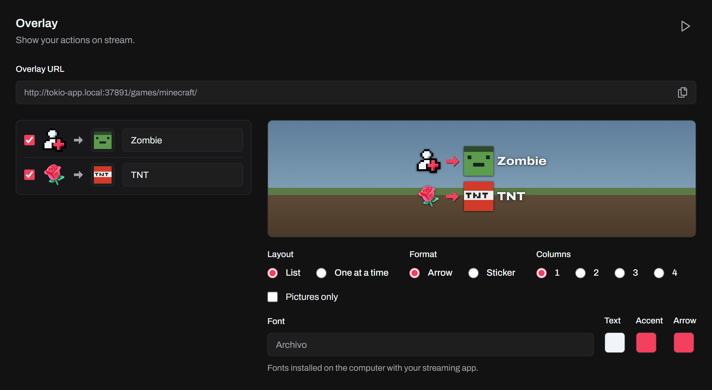

Let viewers do things in your Minecraft world: a gift spawns a mob, a follow gives you an item, a chat keyword changes the weather. Connect the game and make your actions on the **Games** page.

Tokio works with **Minecraft Bedrock Edition** and **Minecraft Java Edition**. Bedrock connects by itself. Java needs the Tokio mod. Both connect from the game's own chat, and Tokio takes one game at a time: when another one connects, it replaces the first.

## Connect Minecraft

1. In Tokio, open **Games** and turn on **Minecraft**. The status reads **Waiting for Minecraft**.
2. Follow your edition's steps below.
3. Type the command shown on the page in the game's chat. Click it on the page to copy it.

Until a game connects, the page shows the setup for both editions side by side, each with its steps and its command. The command has your PC's address.


When the game connects, the status says **Connected to Bedrock Edition** or **Connected to Java Edition**, and the setup steps go away.

Tokio listens for the game only while **Minecraft** is on. It's off until you turn it on, and the switch is the same for all profiles.

## Bedrock Edition

Bedrock needs a world with cheats on, and one setting changed once.

1. In Minecraft, open **Settings → General → Network settings** and turn on **Enable WebSockets**. **Require Encrypted WebSockets** can stay on.
2. Open a world with cheats on.
3. Type the command shown on the page in the game's chat, like this one:

```
/connect 192.168.1.20:37892
```

When you leave the world, the connection ends and the status goes back to **Waiting for Minecraft**: type the command again next time.

If it doesn't connect:

- The status says **Port 37892 is in use**: another program holds the port. Close it, then turn **Minecraft** off and on.
- The game says WebSockets are off: turn on **Enable WebSockets**, as in step 1.
- The game won't take the command: the world needs cheats on.

## Java Edition

Java Edition connects through the Tokio mod, a mod for Fabric. It works in single-player worlds, and in LAN worlds you host. It doesn't work on dedicated servers. Cheats aren't needed: the mod runs Tokio's commands as you, where you stand, with the permission a command block has. Their answers don't show in the game's chat.

### Install the mod

You do this once. The mod is for Minecraft Java **26.3**.

1. Install [Fabric Loader](https://fabricmc.net/use/installer/) for Minecraft 26.3.
2. Download [Fabric API](https://modrinth.com/mod/fabric-api) for 26.3 and put it in Minecraft's `mods` folder.
3. Download the Tokio mod's `.jar` from its [releases page](https://github.com/tokio-app/minecraft-mod/releases/latest) and put it in the same `mods` folder.
4. Start Minecraft with the Fabric profile.

### Connect

1. In Tokio, open **Games** and turn on **Minecraft**.
2. Open a world. Cheats can stay off.
3. Type the command shown on the page in the game's chat, like this one:

```
/tokio connect 192.168.1.20:37892
```

On the same PC as Tokio, `/tokio connect` is enough. The mod never reconnects by itself: type the command again each time you open the world.

| Command                    | What it does                                       |
| -------------------------- | -------------------------------------------------- |
| `/tokio`                   | Says whether the world is connected to Tokio       |
| `/tokio connect [address]` | Connects to Tokio, at `localhost:37892` by default |
| `/tokio disconnect`        | Disconnects from Tokio                             |

Only the world's host can use them.

### If it doesn't connect

- The game doesn't know `/tokio`: the mod isn't loaded. Check that Minecraft runs with the Fabric profile, and that Fabric API and the Tokio mod are in the `mods` folder.
- The chat says **Couldn't connect to Tokio at …**: turn on **Minecraft** in Tokio, and check that the address in the command is one of your PC's addresses, as the page shows them.
- The chat says **Disconnected from Tokio.** with a reason. **Another game connected to Tokio.** means another game replaced this one. **Minecraft was turned off in Tokio.** means the switch on the **Games** page was turned off. Type `/tokio connect` again to come back.
- A guest in your LAN world can't use the commands: only the host can.

## Another device

The same command works when Minecraft runs on another device on the same network as your PC, like a phone for Bedrock, or another PC for Java. If your PC has more than one address, the page shows a command for each: use the one on your device's network.

## Actions

An action is a trigger and the steps that run when it happens. Click **+** next to **Actions** to add one, then pick its edition, its trigger and its steps. Each action has its own switch, an **Edition** picker, a **Test** button, a **Duplicate** button and a button to remove it. Actions belong to the profile.


An action is for one edition, **Bedrock** or **Java**. New actions take the edition of the game that's connected, or Bedrock when none is. The mob and item lists show that edition's own. When you change an action's edition, Tokio moves its mobs and items to the other edition's, by their English name. One with no match becomes a zombie, or a diamond for an item.

**Duplicate** copies an action and puts the copy right after it. Change the copy's edition to run the same steps in the other game.

Triggers and their filters are the same as for [alerts](/docs/features/alerts/#triggers), without the joins, envelopes, Super Fan Boxes and song changes: Chat, Emote, Follow, Share, Like, Gift and Super Fan. Like also takes a number of likes.

- **Gift**: pick the gifts, and choose **When streak ends** or **Every gift**, as in [gift alerts](/docs/features/alerts/#gift-alerts). With **Every gift**, the steps run once for each gift sent.
- **Chat**: type a keyword or phrase to run only for messages that have it.
- **Like**: choose how many likes run it, 100 to start. Likes from all viewers count together, as for the [countdown timer](/docs/features/countdown-timer/): **every 100 likes** runs the steps once each time the LIVE gets 100 more. The count starts over when you disconnect.
- **Emote**: pick the emotes, or leave it for any.

Actions run while **Minecraft** is on, whether or not the features on **Home** are. An action runs only while a game of its edition is connected: a Java action does nothing while Bedrock is connected, and the other way round.

## Steps

Steps run in order, as the player in the game. Click **Add step** to add one.

- **Spawn mob**: pick a mob, how many (1 to 100), and an optional name. The mobs appear where you stand.
- **Give item**: pick an item and how many (1 to 100). You get it.
- **Weather**: **Clear**, **Rain** or **Thunder**.
- **Time of day**: **Day**, **Noon**, **Night** or **Midnight**.
- **Command**: any command, typed as in the game's chat, with or without the slash. Use it for anything else, like effects, titles or sounds:

```
say {username} sent {count} {gift}!
```

A command step runs as you typed it, so write it for the action's edition: some commands differ between Bedrock and Java. A mob or item that doesn't exist in the game runs nothing.

## Variables

A mob's name and a command can use the trigger's details. Click a variable under the steps to add it, or type it.

- `{username}` and `{handle}`: every trigger
- `{comment}`: Chat and Emote
- `{gift}` and `{count}` (the streak's size): Gift. **Every gift** has no `{count}`, since the steps run once for each gift.
- `{count}` (the likes sent): Like

Viewers choose their own names and messages, so Tokio cleans what a variable adds before it goes into a command. It removes quotes (`"` and `'`), backslashes, brackets and braces (`[ ] { }`), `§`, `@` and control characters, and cuts the text to 100 characters. Your own text in the step stays as you wrote it.

## Test

The play button on an action runs its steps once with sample values, like a made-up viewer. Below the steps, Tokio says how many commands ran, or how many failed, and lists the last 25 with the game's answer to each. A command the game refuses shows in red, and the game answers in its own language. Click the line with the count to fold the list, or to open it again.

Test needs a connected game of the action's edition. With no game connected, it says to turn on Minecraft and connect the game first. With the other edition connected, it says to connect Minecraft Java Edition first, or Bedrock Edition.

## Show your actions on stream

Viewers can't see what a gift does until it happens. The **Overlay** section on **Games** builds a menu for your stream: each action is a row with the event, an arrow, and a picture and a name you choose, like a Rose, an arrow and a TNT block.



Turn on the overlay server in **Settings → Overlay Server**, and add the games overlay to your streaming app like any other (see [Adding an overlay](/docs/guides/adding-an-overlay/)). Copy its address from the **Overlay URL** field. The section tells you when the server is off.

```
http://tokio-app.local:37891/games/minecraft/
```

The overlay fills its source and shrinks to fit, so any size and any number of rows work.

To spread your actions over the screen, split the overlay into up to 4 **Columns**. Each column is its own overlay with its own address, like `http://tokio-app.local:37891/games/minecraft/2/` for the second, and the **Overlay URLs** field lists them all. Add each one to your streaming app as a source and place it where you like.

### Rows

Each action has a row, in the order of your actions. A row has:

- **Show**: a check to put the action on the overlay. An action shows only while it's on, **Show** is checked, and it has a picture or a name.
- The event: a gift's or an emote's picture, or Tokio's own pixel picture: a heart for likes, with how many it takes on its corner, a viewer with a plus for follows, an arrow for shares, a crown for Super Fans, and a speech bubble for chat, with its keyword beside it, like **“tnt”**. A gift or emote trigger with none picked shows text, like **Any gift**. Several gifts take turns in one place, every 2 seconds, in the row and on stream. Type over chat's keyword or an event's text to change it, and empty it to go back to the automatic text.
- The picture: click the square to pick a picture of what the action makes, like a TNT block.
- The name: what the action makes, like **Primed TNT** or **Zombie**, named after its steps until you type your own, like **TNT**. Empty it to go back to the step's name. A command makes nothing to name, so type one if you want it. How many it makes shows on the picture's corner, like a stack in your inventory; without a picture, the name says it, like **Zombie ×5**.
- **Column**: which column's overlay shows it, with more than one column.

The preview beside the rows shows how the overlay looks, each column side by side. The row of an action you turned off is dimmed, since it doesn't run.

### Pictures

Tokio can't include Minecraft's own pictures, so you add yours: png, jpg, gif and webp files up to 50 MB. Animated gifs and webps still move. Click the square, then **Browse files...**, and pick one or several at once. The first goes on the action.

The pictures live in a library that all profiles share, in the `games/minecraft` folder of Tokio's app folder. **Clear** takes an action's picture off and keeps the file. To delete a picture, use its delete button in the picker and confirm: it goes off every action in every profile.

### Look

- **Layout**: **List** shows every row at once. **One at a time** shows one row and turns to the next every 3 seconds. A row with several gifts stays until each of its gifts has shown, 2 seconds each.
- **Format**: **Arrow** shows the event, an arrow and your picture side by side, like Rose ▸ TNT. **Sticker** shows your picture large, with the event's picture stuck on its bottom left corner, and no arrow.
- **Columns**: how many overlays the rows split into, from 1 to 4.
- **Pictures only** hides the texts next to pictures. A side without a picture keeps its text, so **Any gift** still shows, and so does chat's keyword, which its bubble can't say.
- **Font**: the name of a font installed on the computer with your streaming app. Empty is Tokio's own, Archivo.
- **Text**, **Accent** and **Arrow**: the color of the texts, of a row that lights up, and of the arrows. **Arrow** shows only with the Arrow format.

### Light-up

When an action runs in the game, its row lights up for a moment: its texts take the accent color, and its pictures glow. If a burst of gifts runs it again and again, it stays lit until 1.5 seconds after the last run. **One at a time** turns to the row that lights up. The **Test** button on an action doesn't light it.

The play button on the **Overlay** section tests the overlay: it lights the next row, in the preview and on stream.

## Limits

There's no limit on runs: every gift on **Every gift** and every count of likes on **Like** runs the action, however many come at once.

- When runs pile up, like 300 roses at once, Tokio spaces out each action's runs, 10 a second, so the game keeps up. Other actions don't wait for them.
- Turning an action off, or removing it, stops the runs it still has waiting. So does the game leaving.
- Runs already waiting still go out after you disconnect from the LIVE.

## Notices

Tokio tells you in a notice when something doesn't work.

- **Minecraft Java Edition isn't connected** (or **Bedrock Edition**): an action ran while **Minecraft** was on and no game of its edition was connected. The notice says to type the `/tokio connect` command, or `/connect` for Bedrock, from **Games** in the game's chat. It shows at most once a minute.
- **A command failed in Minecraft**: the game refused a command, with its answer, like a mob that can't spawn there. It shows at most once every 30 seconds for each action.
- **Tokio couldn't listen for Minecraft**: the port was in use when Tokio started.
