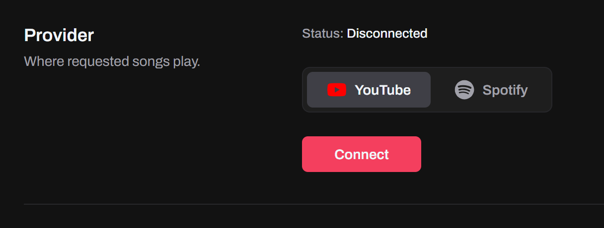
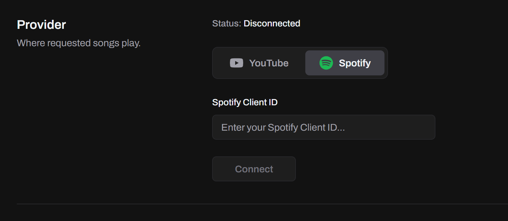
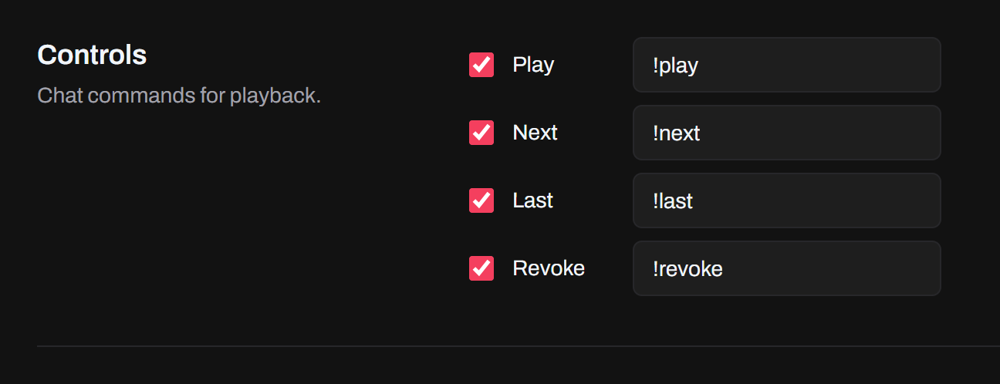
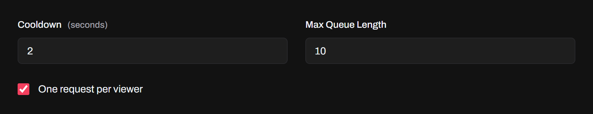

Viewers request songs from chat. **YouTube** songs play in Tokio's own player window, and **Spotify** songs in your Spotify app, on your computer or your phone. Set it up on the **Music** page, and turn **Music** on under **Active Features** on **Home**.

## Providers

Pick where songs play under **Provider** on the **Music** page. Both providers need a Premium account.

### YouTube

Songs play from YouTube Music in Tokio's own player window. You need **YouTube Premium** or **YouTube Music Premium**: on a free account, ads play between songs and can delay them or cut them short.

1. Pick **YouTube** and click **Connect**.
2. Sign in to your Google account in the window that opens. Tokio remembers it for next time.

Keep the player window open while you stream: closing it disconnects music.

### Spotify

Songs play in the Spotify app you have open, on your computer or your phone. You need **Spotify Premium**: Spotify only lets Premium accounts control playback from another app, and create the app that Tokio connects through.

That app is your own, made once in Spotify's developer dashboard, and its Client ID is what Tokio asks for:

1. Open the [Spotify Developer Dashboard](https://developer.spotify.com/dashboard) and log in with your Spotify account.
2. Create an app. Any name and description work, like "Tokio".
3. Add this redirect URI, exactly as written: `http://127.0.0.1:5173/callback`
4. If it asks which APIs you'll use, check **Web API**.
5. Accept Spotify's terms and save.
6. Open the app's **Settings** and copy its **Client ID**. Tokio doesn't need the client secret.

Then, on Tokio's **Music** page:

1. Pick **Spotify** and paste the ID in **Spotify Client ID**.
2. Click **Connect**, log in to Spotify and agree to let Tokio control your playback.

Before your LIVE, open Spotify and play a song, so Tokio has a device to play on.

:::note
Connect with the Spotify account that created the app. To use another one, add it to the app's users in the dashboard first: Spotify allows up to five.
:::

## Chat commands

Rename or turn off each command under **Controls**. Viewers can type them in any case.

| Command   | Action                                   |
| --------- | ---------------------------------------- |
| `!play`   | Request a song                           |
| `!next`   | Skip to the next song                    |
| `!last`   | Go back to the last song                 |
| `!revoke` | Remove a song from the queue by its name |

`!play One More Time` adds that song. `!revoke` takes the song's name as typed or as it shows in the queue. Without a name, `!play` and `!revoke` do nothing.

## Who can request

Music has its own **Permissions** and **Protection**, set like [text-to-speech's](/docs/features/text-to-speech/#permissions). The cooldown is shared: after any command, Tokio ignores every command until it passes, whoever sends it.

Turn on **One request per viewer** to keep one viewer from filling the queue: their next `!play` is ignored while their song waits. A song that's already playing or waiting isn't added again.

Song changes are a LIVE event too, so they can trigger an [alert](/docs/features/alerts/) or update an [overlay](/docs/features/overlays/).
