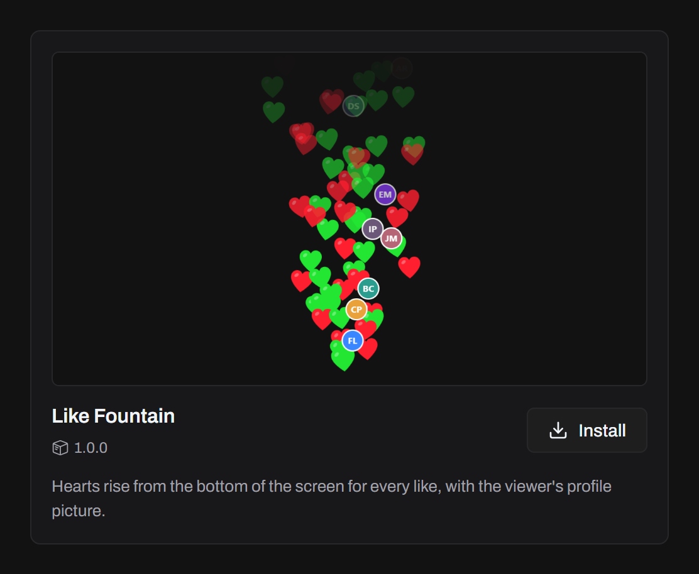
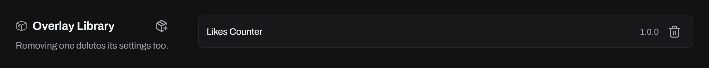
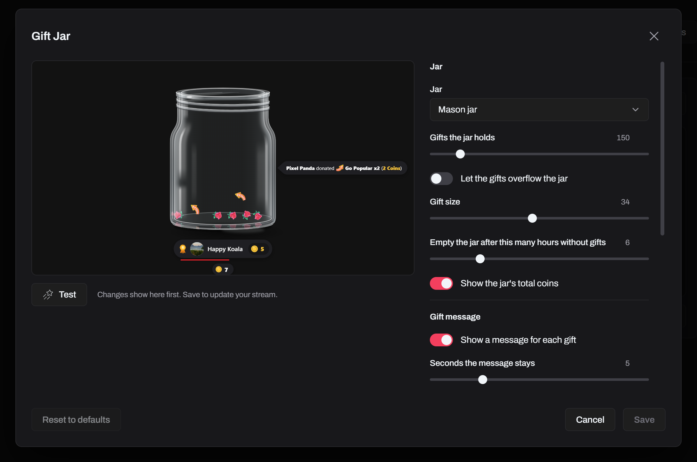
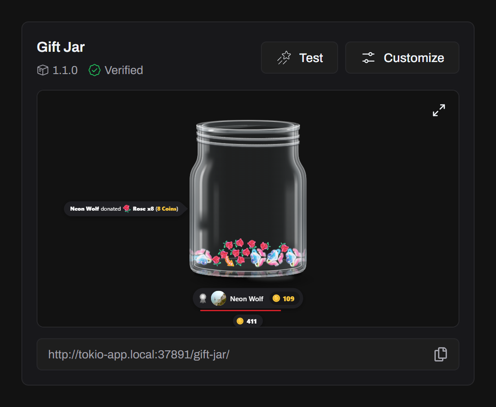

Overlays are web pages that react to your LIVE: a gift jar, a likes leaderboard, a follow banner. Tokio serves them from your computer and sends them every LIVE event.

## Install an official overlay

On **Overlays**, click **Official Overlays** to see the ones made for Tokio, also listed on this site's [Overlays page](/overlays/). Click **Install**, and it shows in the gallery marked **Verified**.



When a new version is out, a dot shows on **Official Overlays** and the button turns to **Update**. Updating keeps your settings that still fit the new version. Refresh the overlay in your streaming app afterwards.

## Import your own

In **Settings → Overlay Library**, import an overlay's folder. It shows in the gallery marked **External**, and gets no updates.



## Set it up

Overlays with settings have **Customize**: colors, text, the gifts they react to and anything else they offer. Changes show in the preview first, and **Save** sends them to your stream. **Reset to defaults** puts them back.



## Add it to your stream

Turn on the overlay server in **Settings → Overlay Server**, then copy the overlay's URL from its card:

```
http://tokio-app.local:37891/<overlay-id>/
```



**Test** sends sample events to the preview, and to the overlay in your streaming app. See [Adding an overlay](/docs/guides/adding-an-overlay/) for OBS and TikTok LIVE Studio.

## Remove an overlay

Remove an official overlay with the trash button on its card in **Official Overlays**, and one you imported in **Settings → Overlay Library**. Tokio asks first, deletes it with its settings, and its URL stops working.

## Make your own

Overlays are web pages, written by hand or with any framework. See [Building an overlay](/docs/developers/building-an-overlay/).
