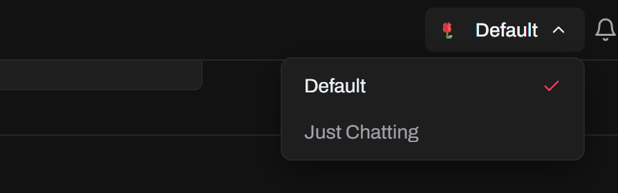
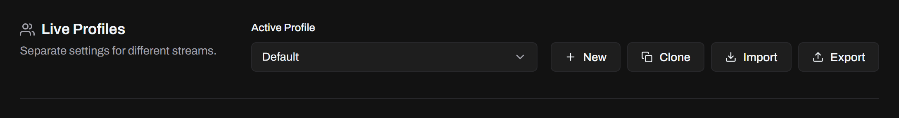
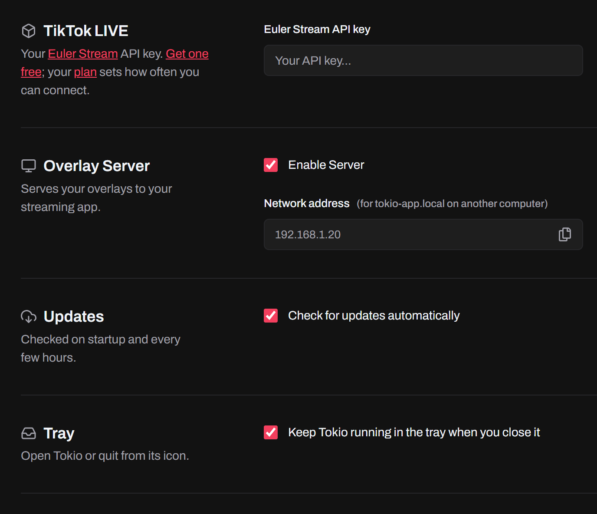
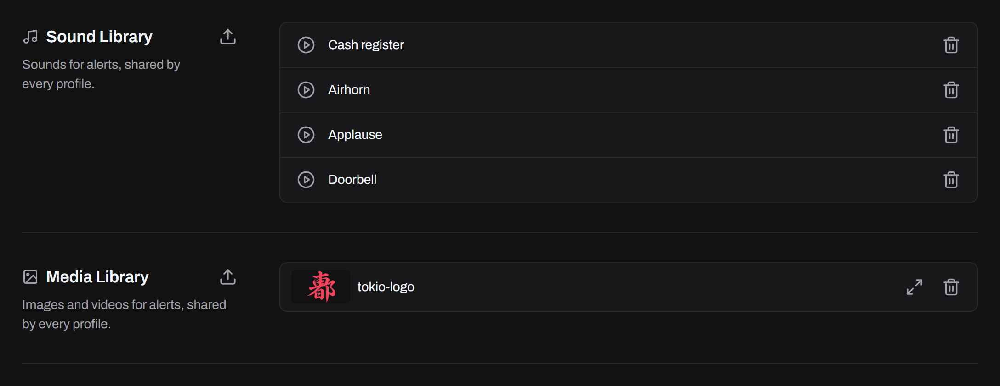
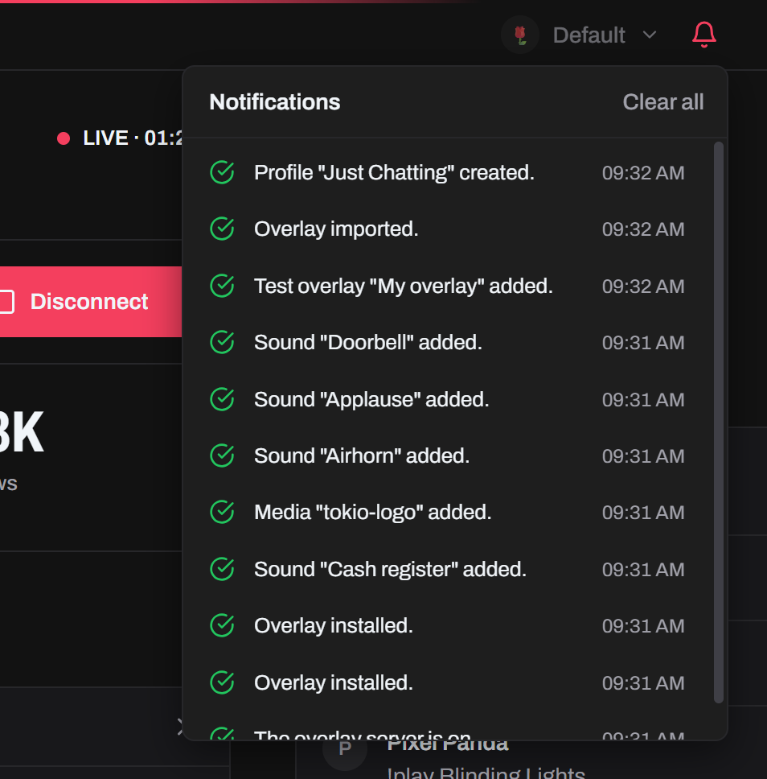

## Profiles

Keep separate settings for different streams. Each profile has its own TTS, music, alerts and countdown timer, and remembers the username you last connected with. Switch profiles from the title bar while you're not connected.

In **Settings → Live Profiles**, **New** creates a blank profile and **Clone** copies the active one. **Import** and **Export** move a profile between computers as a file.

Tokio saves your changes as you make them.

## Settings

- **TikTok LIVE**: your [Euler Stream](https://www.eulerstream.com) API key, which Tokio needs to connect. [Sign up](https://www.eulerstream.com/register) for free.
- **Overlay Server**: turns on the server for overlays, and shows your computer's network address for a streaming app on [another computer](/docs/guides/adding-an-overlay/#on-another-computer).
- **Updates**: turn off the automatic checks for new versions.
- **Tray**: keep Tokio running in the tray (the menu bar on macOS) when you close its window. Click the icon or **Open Tokio** to bring it back, and **Quit Tokio** to quit.
- **Voice Engines**: your TikTok session ID, so TikTok voices come straight from TikTok instead of a third-party proxy.

## Libraries

**Sound Library** and **Media Library** hold the sounds, images and videos your alerts use, for all profiles. Upload, preview and delete them there. Deleting one removes it from every alert, after you confirm.

**Overlay Library** holds the [overlays you import](/docs/features/overlays/#import-your-own).

## Notifications

When something fails, such as a voice that can't be made or a sound that's missing, Tokio tells you what went wrong. The bell in the title bar keeps the session's history.

