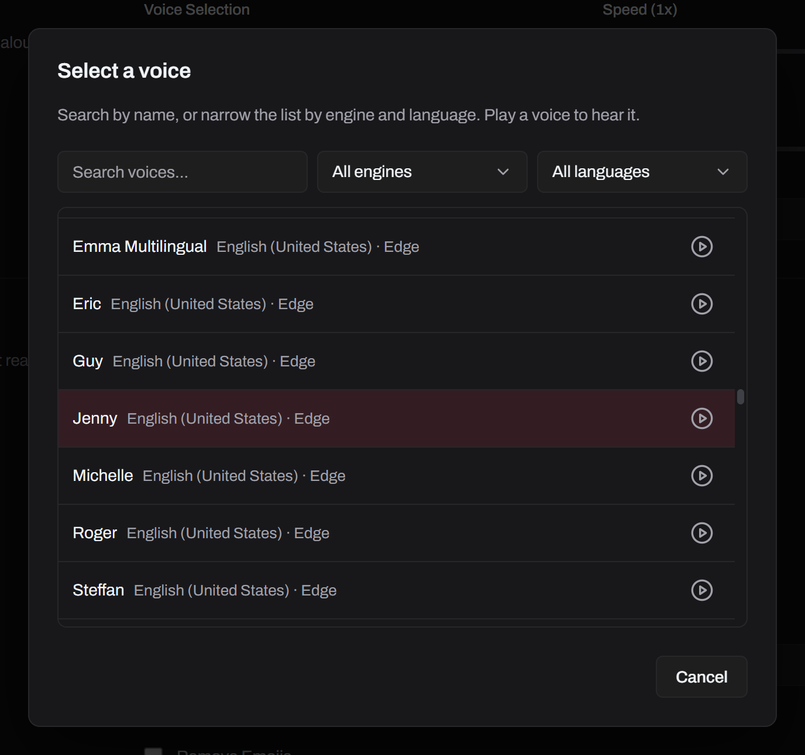
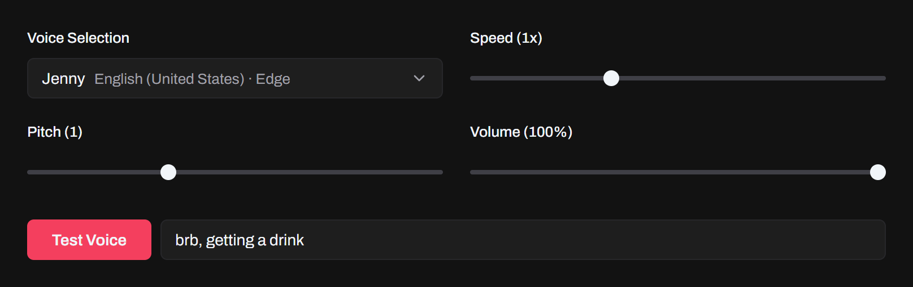
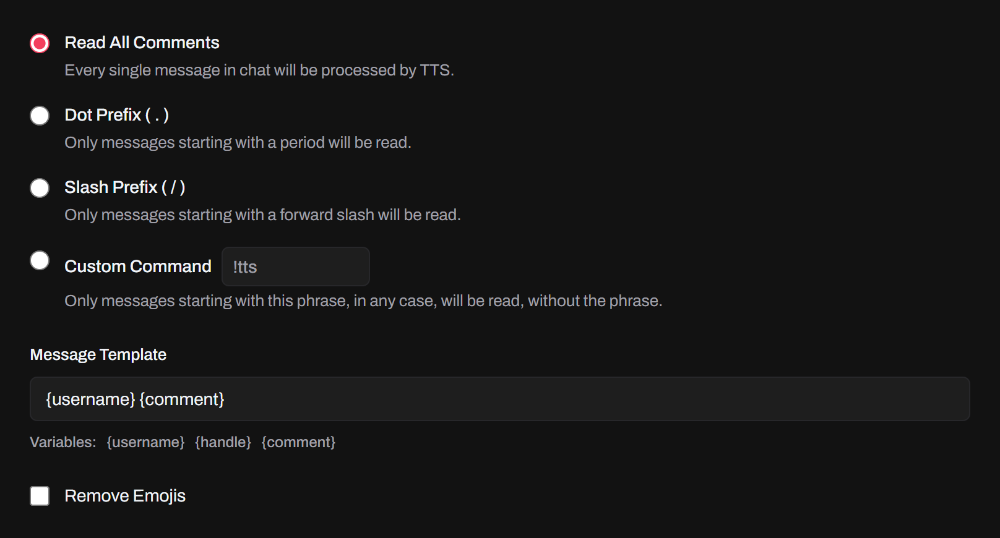
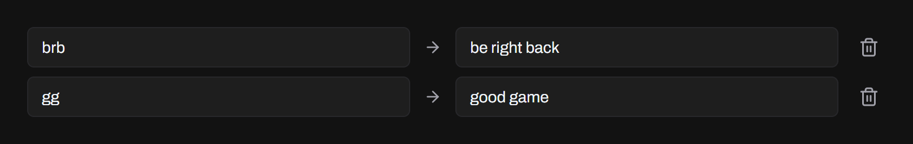
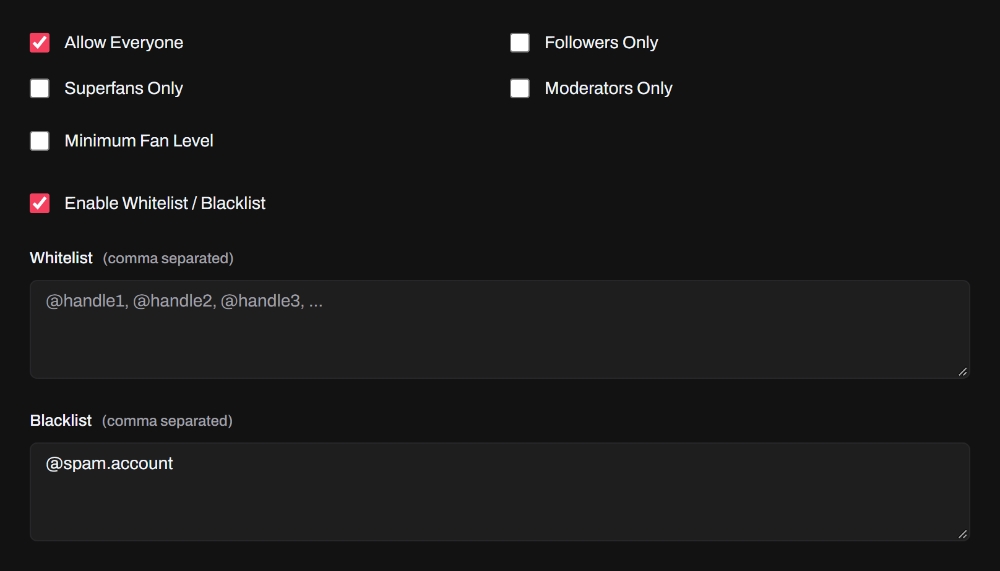
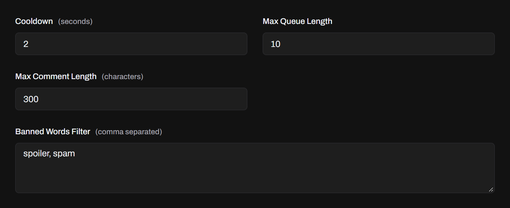

Chat messages are read aloud as they come in. Set it up on the **TTS** page, and turn **TTS** on under **Active Features** on **Home**. Changes save as you make them.

## Voices

The **TTS** page lists the voices of three engines in one place:

- **TikTok**: TikTok's voices. Without setup they go through `tiktok-tts.weilnet.workers.dev`, a proxy run by a third party, which gets the text of every message they read. Add your TikTok session ID in **Settings → Voice Engines** to get them from TikTok instead.
- **Edge**: Microsoft Edge's voices.
- **Windows**: the voices installed on Windows, SAPI and OneCore, 32-bit ones included.

Click the voice to open the list. Search it, filter it by engine and language, and play any voice before you pick it.

Set the speed, pitch and volume. To hear a message the way chat is read, type it and press **Test Voice**. If chat wouldn't read it, say for a banned word, you see why instead.

## Format

Read every message, or only the ones that start with a dot, a slash or a command of your own, like `!tts`. The command isn't read aloud.

The **Message Template** sets what's read:

| Placeholder  | Replaced with                        |
| ------------ | ------------------------------------ |
| `{username}` | The viewer's display name            |
| `{handle}`   | The viewer's handle, without the `@` |
| `{comment}`  | The chat message                     |

`{username} {comment}` reads "Lucia hi from Lima!".

Some voices read emojis by name, like 😂 as "face with tears of joy". **Remove Emojis** leaves them out, and skips messages that are only emojis.

## Replacements

Teach the voice to say acronyms, slang and names. Each replacement swaps a whole word, in any case, for how it should sound. Replacements apply before **Remove Emojis**, so one can still turn ❤️ into "love".

## Permissions

**Allow Everyone** lets anyone talk. Uncheck it to allow only followers, superfans, moderators or a minimum fan level. With **Enable Whitelist / Blacklist**, blacklisted @handles are never read, and a whitelist with names lets only them talk.

## Protection

A **Cooldown** between messages and a **Max Queue Length** keep chat from flooding the voice. Messages over the **Max Comment Length** are skipped, and so are messages with a banned word in the comment, the name or the @handle. Banned words are caught even with capitals, accents, look-alike letters or hidden characters.

Replacements, **Remove Emojis** and banned words also apply to [alerts that speak](/docs/features/alerts/#spoken-messages). [Music requests](/docs/features/music-requests/) have their own permissions and protection.
