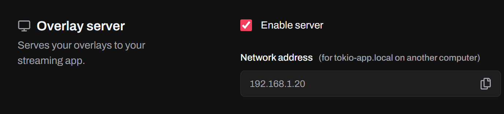

Overlays are served by Tokio's overlay server. Turn it on in **Settings → Overlay Server** with **Enable Server**, and confirm.



The first time, your system asks for administrator rights (your password on macOS and Linux) so Tokio can add its address to your hosts file. Accept it, or the server stays off.

## The overlay address

TikTok LIVE Studio doesn't accept `localhost` links, so overlays use their own address, `tokio-app.local`. Copy each one in Tokio:

- An [overlay's](/docs/features/overlays/), from its card on **Overlays**:

  ```
  http://tokio-app.local:37891/<overlay-id>/
  ```

- An [alert's media](/docs/features/alerts/#images-and-videos), from the media picker on **Alerts**:

  ```
  http://tokio-app.local:37891/alerts/<alert-id>/
  ```

- The [countdown timer's](/docs/features/countdown-timer/), from **Tools**:

  ```
  http://tokio-app.local:37891/timer/
  ```

- The [games overlay](/docs/features/games/#show-your-actions-on-stream), from **Games**:

  ```
  http://tokio-app.local:37891/games/minecraft/
  ```

  With more than one column, each has its own address, like `http://tokio-app.local:37891/games/minecraft/2/`.

## OBS Studio

1. In **Sources**, click **+** and choose **Browser**.
2. Paste the overlay URL and set the width and height to your canvas size.

## TikTok LIVE Studio

1. Click **Add source** and choose **Link**.
2. Paste the overlay URL and place the overlay on your scene.

## Other apps

Any app that can show a web page works the same way: add a browser or web source and paste the URL.

## On another computer

If your streaming app runs on another computer on your network, point `tokio-app.local` there to the computer Tokio runs on, at the network address shown in **Settings → Overlay Server**:

- Add a line with that address and `tokio-app.local` to the other computer's hosts file, as administrator. It's `C:\Windows\System32\drivers\etc\hosts` on Windows and `/etc/hosts` on macOS and Linux:

  ```
  192.168.1.20 tokio-app.local
  ```

- Or add a DNS entry for `tokio-app.local` with that address on your router.

The overlay URLs then work there as they are. If Windows asks whether to allow Tokio through the firewall, allow it, or the other computer can't connect.

:::tip
Tokio has to stay open while you stream so the overlays keep getting events.
:::
