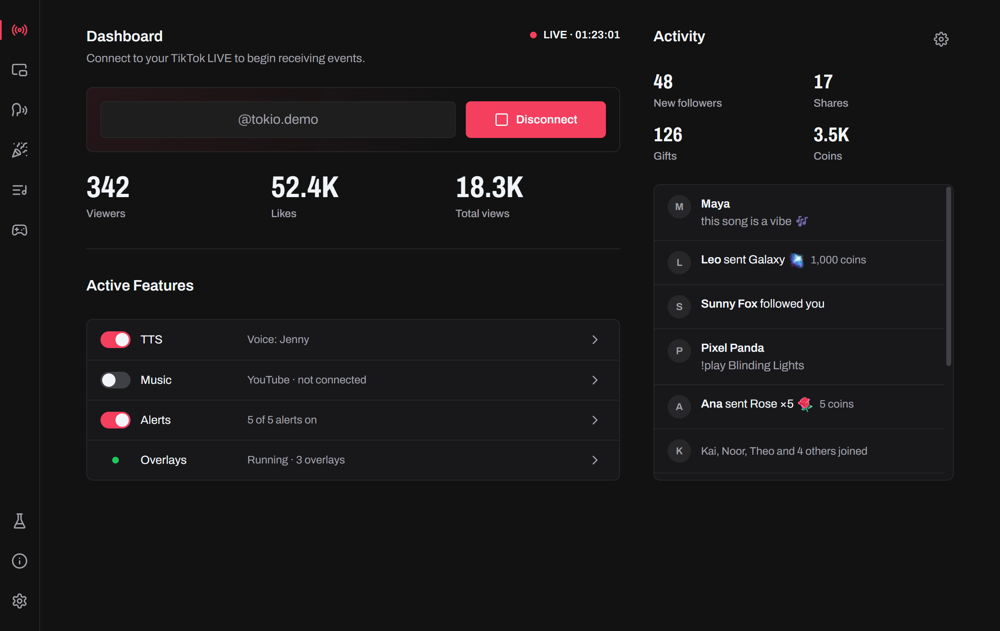

import { CardGrid, LinkCard } from "@astrojs/starlight/components";

Tokio is a desktop app for Windows, macOS and Linux that reacts to your TikTok LIVE. It reads chat aloud, takes song requests, plays alerts, runs commands in Minecraft and drives overlays in **OBS**, **TikTok LIVE Studio** or any streaming app that can show a web page.

It runs on your own computer, so keep it open while you stream.

## Start here

<CardGrid>
  <LinkCard
    title="Install"
    description="Download Tokio for your system."
    href="/docs/install/"
  />
  <LinkCard
    title="Connect to your LIVE"
    description="Turn on the features you want, then go live and connect."
    href="/docs/connect/"
  />
  <LinkCard
    title="Adding an overlay"
    description="Show Tokio's overlays in OBS or TikTok LIVE Studio."
    href="/docs/guides/adding-an-overlay/"
  />
  <LinkCard
    title="Building an overlay"
    description="Make your own overlay and test it with sample events."
    href="/docs/developers/building-an-overlay/"
  />
</CardGrid>

## Features

- **[Text-to-speech](/docs/features/text-to-speech/)**: chat read aloud as it comes in.
- **[Music requests](/docs/features/music-requests/)**: viewers queue songs from chat, on YouTube Music or Spotify.
- **[Alerts](/docs/features/alerts/)**: sounds, spoken messages, images and videos for follows, gifts and other LIVE events.
- **[Games](/docs/features/games/)**: gifts, follows and chat spawn mobs and run commands in Minecraft.
- **[Overlays](/docs/features/overlays/)**: install the official overlays or import your own.
- **[Countdown timer](/docs/features/countdown-timer/)**: a clock on your stream that viewers add time to.
- **[Profiles and settings](/docs/features/profiles-and-settings/)**: separate settings for different streams.

## Dashboard

The **Home** page is where you connect and follow your LIVE: how long you've been on, the viewers, likes and views, the new followers, shares, gifts and coins, and an **Activity** feed of what viewers do.

Under **Active Features**, turn TTS, music and alerts on or off. Each shows what it will do, such as the voice or whether music is connected.
