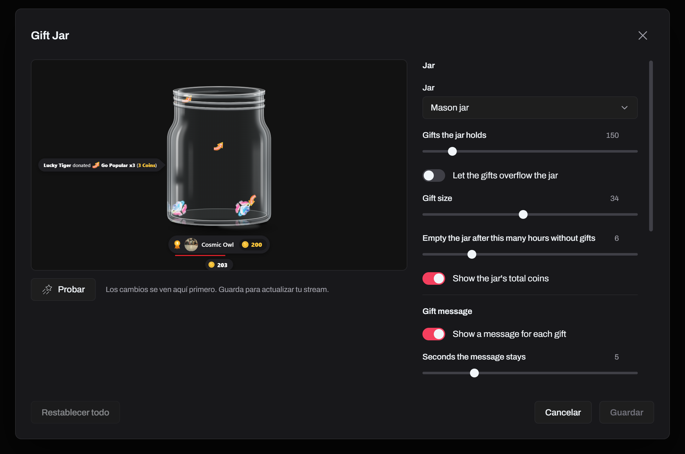
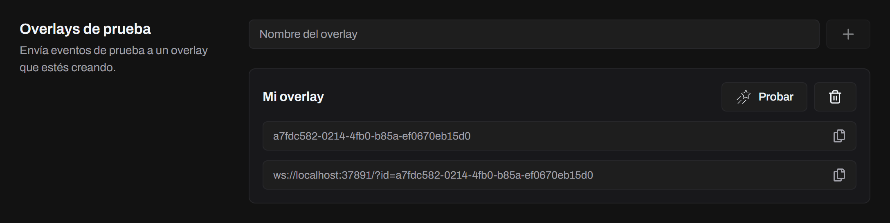

Un overlay es una página web, escrita a mano o hecha con React, Vue, Svelte o cualquier otro framework: Tokio solo necesita la carpeta terminada. La sirve en `http://tokio-app.local:37891/<overlay-id>/` y le envía a la página cada evento del LIVE por un WebSocket.

## Estructura de la carpeta

```
my-overlay/
├── info.yaml     # nombre y versión
├── config.yaml   # configuración que se muestra en la galería de Tokio (opcional)
└── index.html    # el overlay, o lo que genera el build de tu framework
```

Los demás archivos de la carpeta (scripts, estilos, imágenes) se sirven junto a `index.html`.

### info.yaml

```yaml
name: Likes Counter
version: 1.0.0
config: true
```

| Clave     | Descripción                                                                                     |
| --------- | ----------------------------------------------------------------------------------------------- |
| `name`    | Se muestra en la galería.                                                                       |
| `version` | La versión de tu overlay.                                                                       |
| `config`  | Obligatoria: `true` cuando el overlay tiene un `config.yaml` con configuración; si no, `false`. |

### El bloque tokio-setup

`index.html` debe tener el bloque tokio-setup, que se abre exactamente con `<script id="tokio-setup">`. Escríbelo tú, antes de los scripts que lo leen:

```html
<script id="tokio-setup">
  window.__OVERLAY_ID__ = "";
  window.__OVERLAY_CONFIG__ = { title: "Likes", main_color: "#ffffff" };
</script>
```

- `window.__OVERLAY_ID__` es obligatorio. Pásaselo a `tokio.connect` en vez de escribir un ID fijo: las vistas previas de Tokio solo llegan al overlay a través de su propio ID.
- `window.__OVERLAY_CONFIG__` es solo para overlays con configuración (`config: true`). Dale los valores predeterminados de `config.yaml`, como se explica en [Configuración](#configuración).

Tokio no importa un overlay que no tenga el bloque. Lo llena con el ID del overlay y su configuración guardada, y agrega un script que dirige el WebSocket del overlay a la computadora correcta cuando lo abre una app de streaming en otra computadora.

## Escuchar los eventos

[`@tokioapp/overlay`](https://www.npmjs.com/package/@tokioapp/overlay) (MIT) se conecta a Tokio y te entrega los eventos. Los overlays que importas lo necesitan, porque las vistas previas de Tokio envían sus eventos al frame del overlay y es la biblioteca la que los recibe. No tiene dependencias, y trae un módulo ES, un build CommonJS y un build para navegador, con tipos de TypeScript.

- `tokio.on(event, callback)` se suscribe a un evento y devuelve una función que cancela la suscripción.
- `tokio.off(event, callback)` quita un callback.
- `tokio.connect(id, url?)` se conecta a Tokio, en `ws://localhost:37891` salvo que le pases otra URL, y se reconecta solo si Tokio se reinicia. Llámalo una vez, cuando arranca el overlay. `tokio.disconnect()` cierra la conexión.

En [Eventos](/es/docs/developers/events/) están todos los eventos y sus datos.

### En una página HTML simple

Carga el build para navegador desde un CDN. Este define la variable global `TokioOverlay`:

```html
<!doctype html>
<html lang="en">
  <head>
    <meta charset="UTF-8" />
    <script src="https://unpkg.com/@tokioapp/overlay@1"></script>
    <script id="tokio-setup">
      window.__OVERLAY_CONFIG__ = { title: "Likes", main_color: "#ffffff" };
      window.__OVERLAY_ID__ = "";
    </script>
  </head>
  <body>
    <h1 id="title">Likes</h1>
    <p id="likes">0</p>

    <script type="module">
      const { tokio, TOKIO_EVENTS } = TokioOverlay;
      const title = document.getElementById("title");
      const likes = document.getElementById("likes");

      function apply(config) {
        title.textContent = config.title;
        title.style.color = config.main_color;
      }

      apply(window.__OVERLAY_CONFIG__);

      // Llega cuando el streamer guarda la configuración del overlay, y con
      // cada cambio mientras la edita en la vista previa de Tokio.
      tokio.on(TOKIO_EVENTS.CONFIG, apply);

      tokio.on(TOKIO_EVENTS.LIKE, (data) => {
        likes.textContent = data.totalLikes;
      });

      tokio.connect(window.__OVERLAY_ID__);
    </script>
  </body>
</html>
```

### Con un framework

Instala el paquete e impórtalo:

```sh
npm install @tokioapp/overlay
```

```js
import { tokio, TOKIO_EVENTS } from "@tokioapp/overlay";

tokio.on(TOKIO_EVENTS.GIFT, (data) => {
  console.log(`${data.user.username} sent ${data.gift.name}`);
});

tokio.connect(window.__OVERLAY_ID__);
```

Como `tokio.on` devuelve su propia función para cancelar la suscripción, sirve directo como limpieza de un componente. En React, por ejemplo:

```jsx
useEffect(
  () => tokio.on(TOKIO_EVENTS.LIKE, (data) => setLikes(data.totalLikes)),
  [],
);
```

Al hacer el build del overlay:

- **Usa rutas relativas para los recursos.** El overlay se sirve en `/<overlay>/`, así que las rutas absolutas como `/assets/app.js` no funcionan. En Vite, pon `base: "./"`.
- **Incluye los archivos YAML en el build.** `info.yaml` y `config.yaml` tienen que quedar junto al `index.html` generado. En Vite, ponlos en `public/` y se copian a la carpeta de salida.
- **Deja el bloque tokio-setup en la plantilla HTML.** Pon el bloque `<script id="tokio-setup">` en tu plantilla `index.html` para que sobreviva al build, y lee `window.__OVERLAY_ID__` (y `window.__OVERLAY_CONFIG__`) en tiempo de ejecución.

Importa en Tokio la carpeta que genera el build (por ejemplo, `dist/`).

## Configuración

Cuando `info.yaml` tiene `config: true`, el [bloque tokio-setup](#el-bloque-tokio-setup) también define `window.__OVERLAY_CONFIG__`, y Tokio lo llena con la configuración guardada del overlay:

```html
<script id="tokio-setup">
  window.__OVERLAY_CONFIG__ = { title: "Likes", main_color: "#ffffff" };
  window.__OVERLAY_ID__ = "my-overlay";
</script>
```

`config.yaml` describe la configuración, que el streamer cambia en la ventana **Personalizar** del overlay. Los campos se agrupan en secciones, y el `id` de cada campo pasa a ser una clave de `__OVERLAY_CONFIG__`:

```yaml
sections:
  - name: General
    id: general
fields:
  - name: Title
    id: title
    type: input
    section: general
    attributes:
      mode: text
      placeholder: Overlay title...
      value: Likes
      default: Likes
  - name: Main color
    id: main_color
    type: color
    section: general
    attributes:
      value: ffffff
      default: ffffff
```

Cada campo tiene un `name`, un `id` único, una `section` (el `id` de una sección) y un `type`. Sus `attributes` siempre incluyen un `value` y un `default` del mismo tipo.

| Tipo       | Otros atributos                                                        | Valor en `__OVERLAY_CONFIG__`                                        |
| ---------- | ---------------------------------------------------------------------- | -------------------------------------------------------------------- |
| `input`    | `mode` (`text` o `number`), `placeholder`                              | El texto o el número                                                 |
| `dropdown` | `options` (`value`, `label`, `img` opcional), `multiple`, `searchable` | El valor elegido, o una lista con `multiple`                         |
| `color`    | ninguno; los valores son códigos hex sin `#`, de 6 u 8 caracteres      | El color con `#`, por ejemplo `"#ffffff"`                            |
| `check`    | ninguno                                                                | `true` o `false`                                                     |
| `toggle`   | ninguno                                                                | `true` o `false`                                                     |
| `slider`   | `min`, `max`                                                           | El número                                                            |
| `gifts`    | `multiple`; los valores son IDs de regalos de TikTok                   | Un regalo `{ value, label, img, coins }`, o una lista con `multiple` |

`mode`, `options` y el `min` y el `max` de un slider son obligatorios; `multiple` y `searchable` son `false` si no los pones. El `id` de cada sección debe ser único, y la `section` de cada campo debe nombrar una de ellas.



## Probar sin importar

Mientras haces un overlay, pruébalo desde la página **Herramientas** en vez de importarlo después de cada cambio. También funciona con el servidor de desarrollo de tu framework:

1. Activa el servidor de overlays en **Configuración → Servidor de overlays**.
2. En **Herramientas → Overlays de prueba**, escribe un nombre y crea un ID.
3. Pon ese ID en el `window.__OVERLAY_ID__` de tu overlay y abre el overlay en tu navegador.
4. Haz clic en **Probar**. Tokio le envía a tu overlay cada evento del LIVE y sigue desde tu última prueba: vuelven los mismos espectadores, los Me gusta y las monedas se van sumando, y un combo de regalos crece durante varios clics antes de terminar.



Si Tokio dice "No hay ningún overlay conectado con este ID.", revisa que la página esté abierta y conectada con el mismo ID.

## Impórtalo

Cuando esté listo, importa la carpeta en **Configuración → Biblioteca de overlays**. Tokio le da un ID, escribe su configuración en la página y la sirve. Más detalles en [Overlays](/es/docs/features/overlays/).

## Sin la biblioteca

Los overlays que importas en Tokio necesitan la biblioteca, porque las vistas previas de Tokio envían sus eventos al iframe del overlay. Una página que no importas puede abrir un WebSocket por su cuenta, a `ws://localhost:37891/?id=<overlay ID>`. Tokio no sirve esa página, así que nadie reescribe su dirección: si se abre en otra computadora, tiene que conectarse a la computadora de Tokio en vez de a `localhost`, ya sea por `tokio-app.local` apuntando a ella o por su dirección de red (la que aparece en **Configuración → Servidor de overlays**). Cada mensaje es un JSON con el nombre del evento y sus datos:

```json
{
  "type": "tokio:event:like",
  "data": { "user": {}, "likeCount": 5, "totalLikes": 1200 }
}
```
